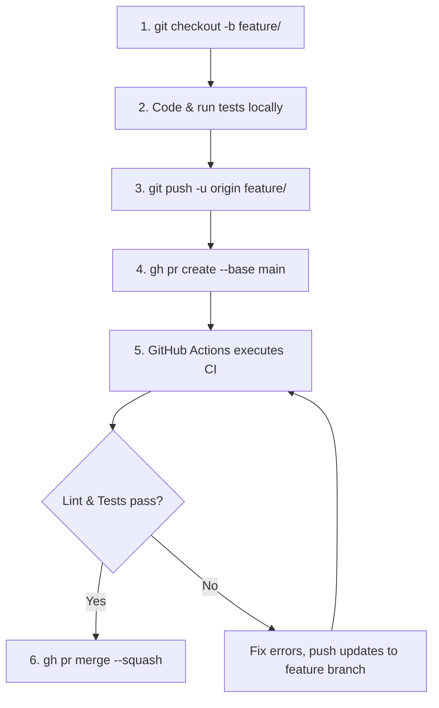

# GitHub Rulesets & Branch Protection

This skill provides the operational guide for navigating, auditing, and maintaining the GitHub Repository Rulesets for the `hydr8` codebase.

---

## 1. Active Rulesets Overview

The primary production branch `main` is protected by a modern GitHub Repository Ruleset:

| Property | Value |
|---|---|
| **Ruleset Name** | `Protect Main Branch` |
| **Ruleset ID** | `26264014` |
| **Target Branch** | `~DEFAULT_BRANCH` (`refs/heads/main`) |
| **Enforcement** | `active` |
| **Bypass Mode** | `RepositoryRole: Admin` (`actor_id: 5`) can bypass in emergency |
| **Direct Web Link** | [Repository Ruleset #26264014](https://github.com/marcusAlmo/hydr8/rules/26264014) |
| **Settings Dashboard** | [Ruleset Management](https://github.com/marcusAlmo/hydr8/settings/rules) |

---

## 2. Enforced Protection Policies

The active ruleset enforces four mandatory safeguards:

1. **Restrict Deletions (`deletion`)**:
   - `main` cannot be deleted through git CLI or the web interface.
2. **Block Force Pushes (`non_fast_forward`)**:
   - `git push --force` or `git push --force-with-lease` to `main` is strictly rejected to preserve commit history.
3. **Require Pull Requests (`pull_request`)**:
   - Commits cannot be pushed directly to `main`.
   - All changes must be proposed via a Pull Request.
   - Requires all review comment threads to be marked as resolved (`required_review_thread_resolution: true`).
   - Approvals required: `0` (enables solo developer workflows while maintaining auditability).
4. **Required Status Checks (`required_status_checks`)**:
   - Merging is blocked until both GitHub Actions CI jobs complete successfully:
     - `Lint (ruff)`
     - `Tests (PostgreSQL)`
   - **Strict Policy Enabled**: Branches must be up-to-date with `main` before merging (`strict_required_status_checks_policy: true`).

---

## 3. How to Navigate & Inspect via CLI

Antigravity and developers can inspect the ruleset directly using the GitHub CLI (`gh`):

### View Current Rulesets
```bash
# List all rulesets
gh api repos/marcusAlmo/hydr8/rulesets

# Inspect the full JSON definition of the active ruleset
gh api repos/marcusAlmo/hydr8/rulesets/26264014
```

### Check Why a Push or PR was Blocked (Rule Suites / Evaluation Insights)
GitHub logs rule evaluations every time a ref is pushed or merged:
```bash
# View recent rule evaluation history
gh api repos/marcusAlmo/hydr8/rulesets/rule-suites

# View details for a specific evaluation ID
gh api repos/marcusAlmo/hydr8/rulesets/rule-suites/<suite_id>
```

### Check PR Mergeability and Gated Status
```bash
# Check if PR is blocked by status checks or rulesets
gh pr view <pr_number> --json mergeStateStatus,mergeable,statusCheckRollup

# List check run details
gh pr checks <pr_number>
```

---

## 4. Standard Development Flow Under the Ruleset

Because direct pushes to `main` are blocked, all work must follow this standard branch-and-PR flow:



1. **Create a Feature Branch**:
   ```bash
   git checkout -b feature/my-feature
   ```
2. **Push to Remote**:
   ```bash
   git push -u origin feature/my-feature
   ```
3. **Create Pull Request**:
   ```bash
   gh pr create --base main --title "feat: description" --body "Summary of changes"
   ```
4. **Verify CI Checks**:
   ```bash
   gh pr checks
   ```
5. **Merge PR**:
   ```bash
   gh pr merge --squash --delete-branch
   ```

---

## 5. How to Update or Modify the Ruleset

### Updating Required Status Checks
When a new CI check or workflow is introduced in `.github/workflows/`:
1. Retrieve current ruleset configuration:
   ```bash
   gh api repos/marcusAlmo/hydr8/rulesets/26264014 > /tmp/ruleset.json
   ```
2. Edit the `required_status_checks` array to include the new context name.
3. Apply the update:
   ```bash
   gh api --method PUT repos/marcusAlmo/hydr8/rulesets/26264014 --input /tmp/ruleset.json
   ```

### Temporarily Setting Ruleset to 'Evaluate' or 'Disabled'
If emergency modifications are needed without deleting the ruleset:
```bash
# Switch to evaluate mode (logs violations without blocking)
gh api --method PUT repos/marcusAlmo/hydr8/rulesets/26264014 -f enforcement="evaluate"

# Re-activate enforcement
gh api --method PUT repos/marcusAlmo/hydr8/rulesets/26264014 -f enforcement="active"
```

---

## 6. Troubleshooting Common Violations

| Error / State | Cause | Resolution |
|---|---|---|
| `remote: error: GH013: Repository rule violations found` | Attempted direct push or force-push to `main`. | Push to a feature branch instead and submit a Pull Request. |
| `mergeStateStatus: BLOCKED` | One or more required status checks failed (`Lint (ruff)` or `Tests (PostgreSQL)`). | Run `gh pr checks` to see the failing job, review logs, fix issues on the feature branch, and push. |
| `mergeStateStatus: BEHIND` | Target `main` has progressed and branch is out of date. | Rebase or merge `main` into the feature branch: `git merge origin/main && git push`. |
| Unresolved conversation | A reviewer left a comment thread that hasn't been resolved. | Resolve conversation threads in GitHub PR UI before merging. |

